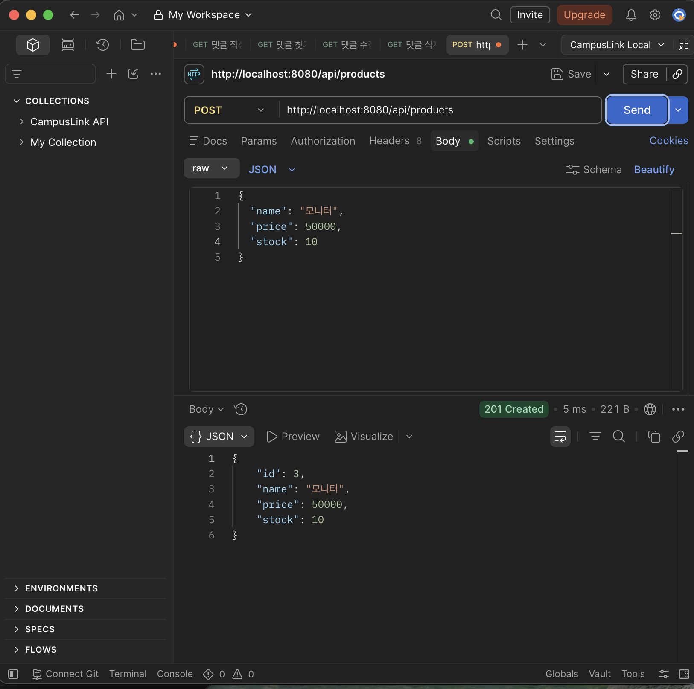
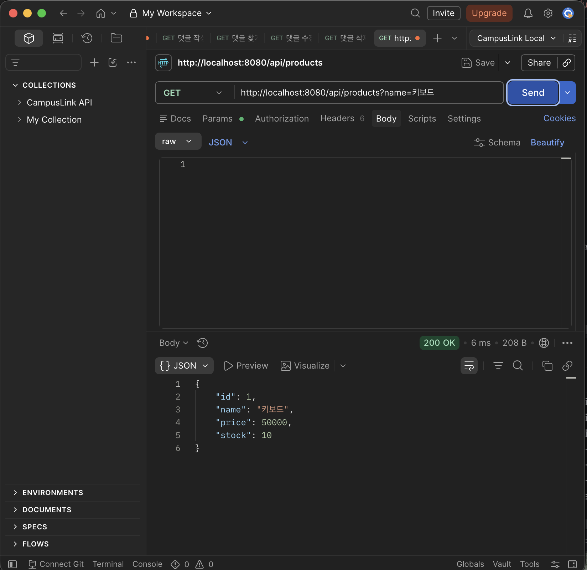
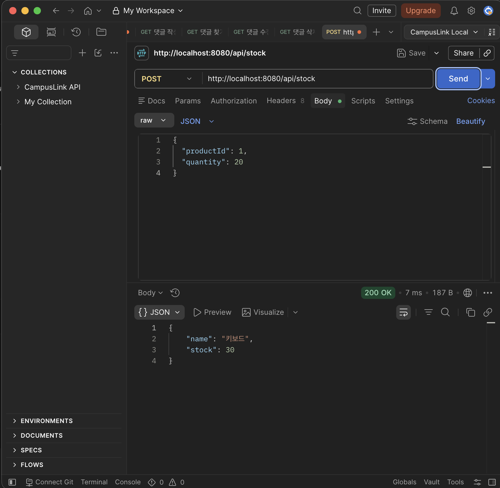
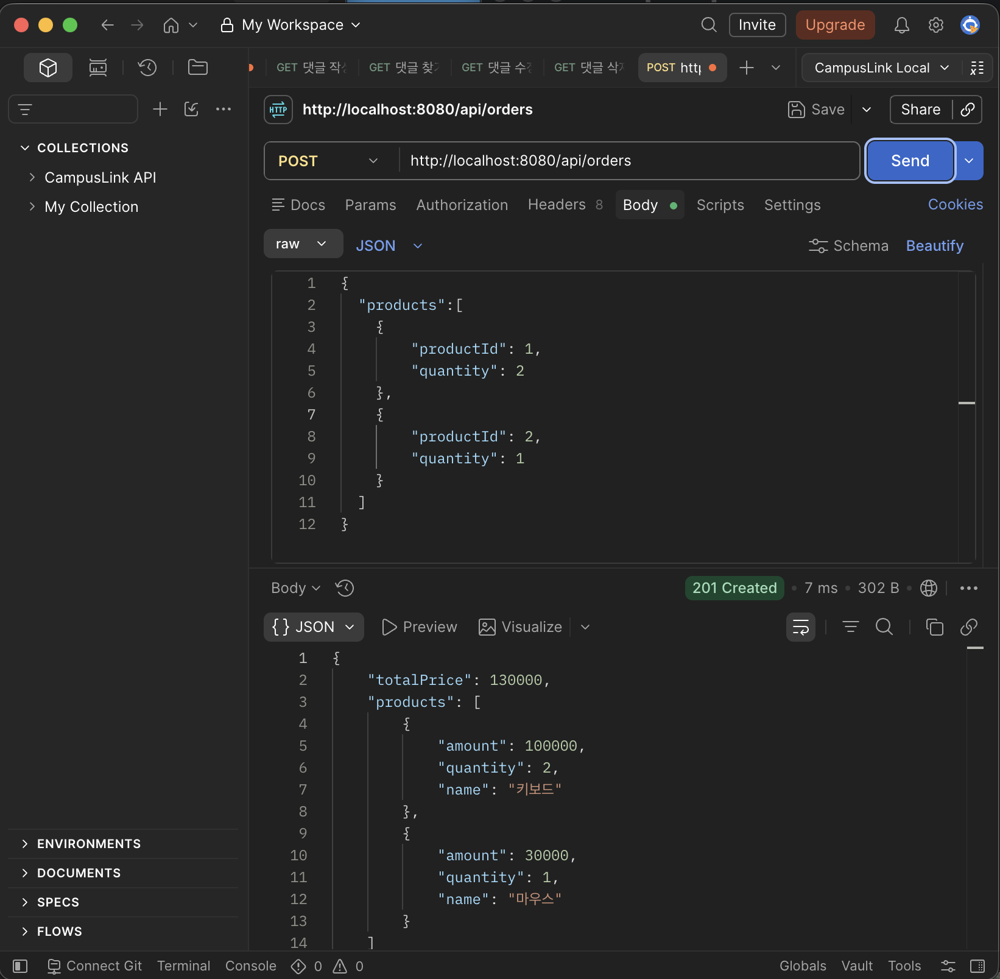
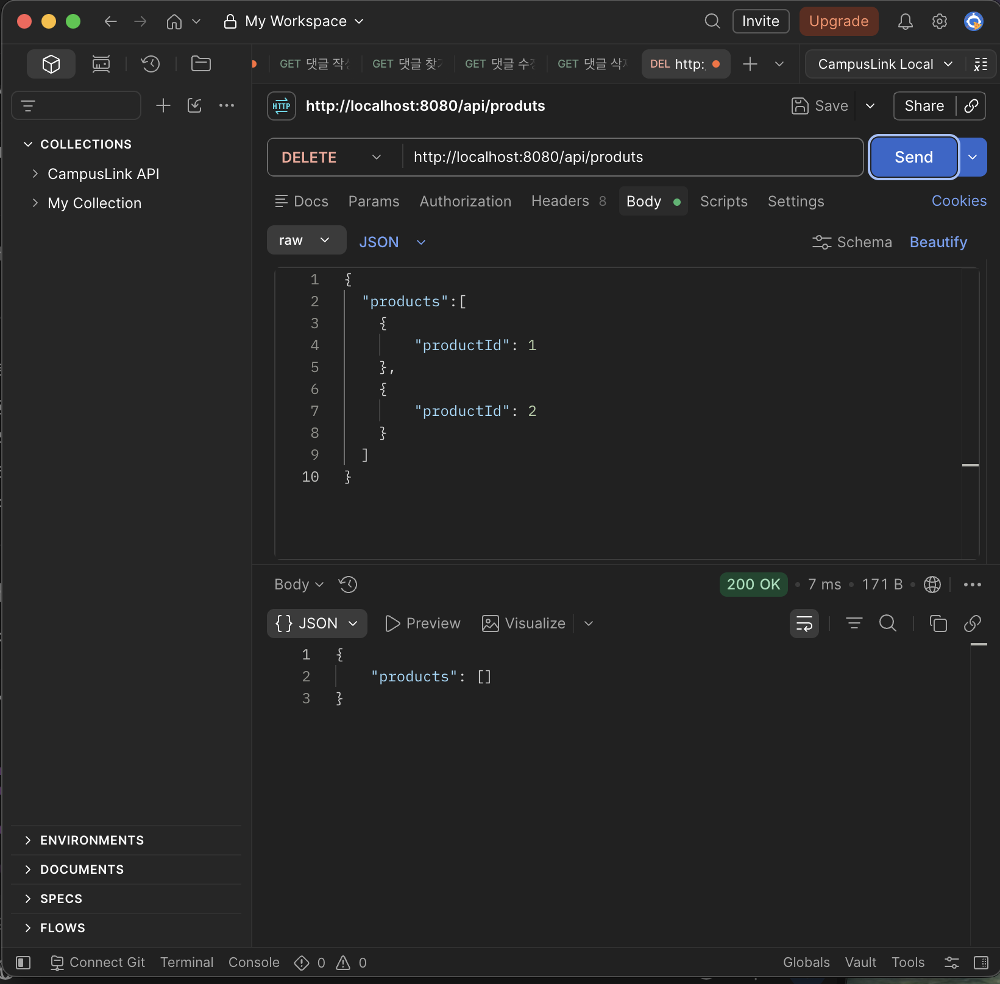

# Week 1 - Postman API 테스트

## 1. 상품 등록 (POST /api/products)

## 2. 상품 조회 (GET /api/products)

## 3. 재고 추가 (POST /api/stock)

## 4. 상품 구매 (POST /api/orders)

## 5. 상품 삭제 (DELETE /api/products)

