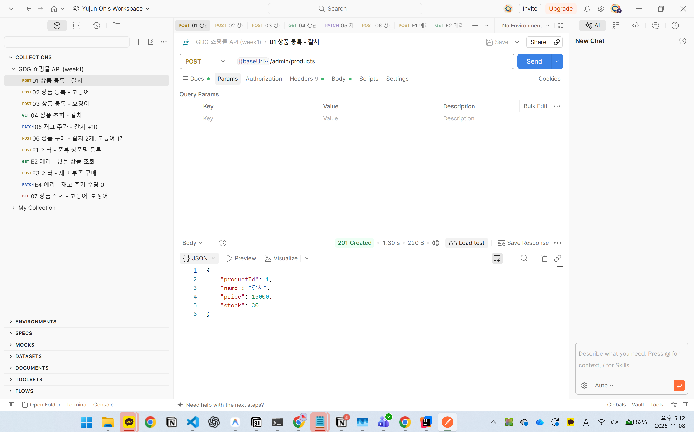
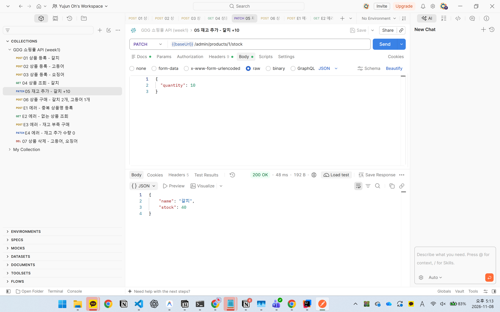
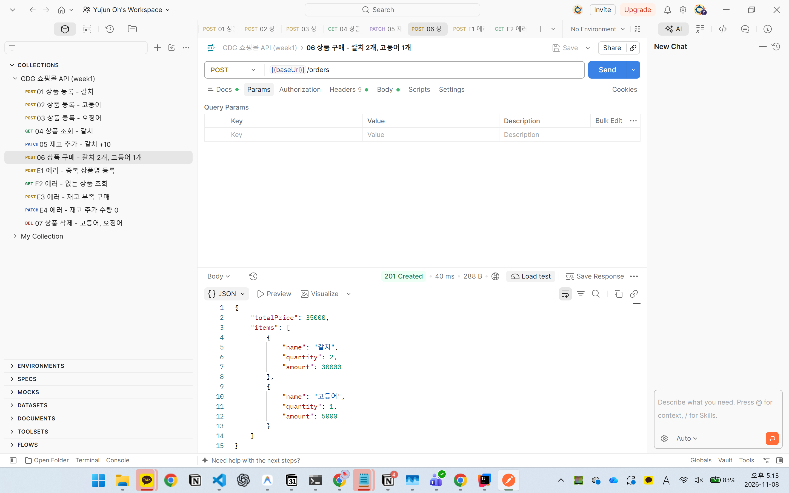
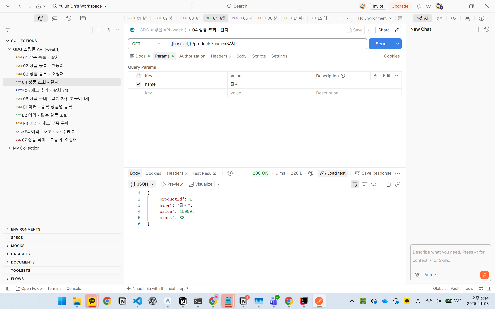
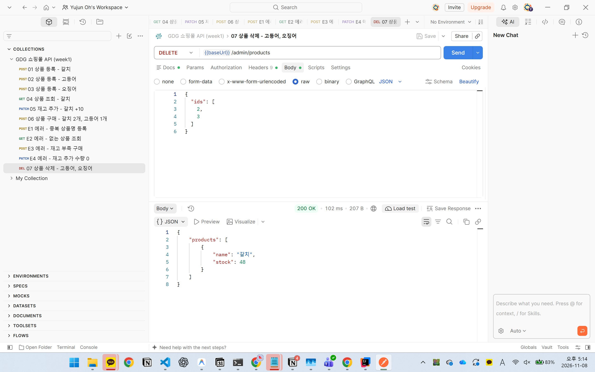

# Week 2 Postman 동작 확인

Entity, Repository, Service 계층을 적용한 뒤 서버를 새로 켜고 요청을 보낸 결과입니다. 데이터는 H2 인메모리 DB에 저장됩니다.

## 상품 등록 (POST /admin/products, 201 Created)

## 상품 조회 (GET /products?name=갈치, 200 OK)

## 재고 추가 (PATCH /admin/products/1/stock, 200 OK)

## 상품 구매 (POST /orders, 201 Created)

## 구매 후 상품 조회 (GET /products?name=갈치, 200 OK)
구매로 2개가 줄어 재고가 38로 조회됩니다. 변경한 재고가 DB에 반영되었습니다.

## 상품 삭제 (DELETE /admin/products, 200 OK)

