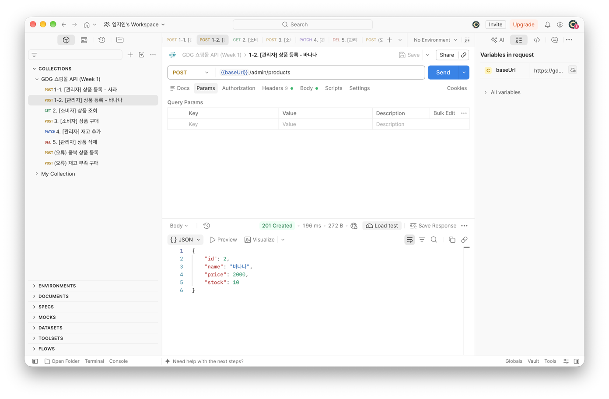
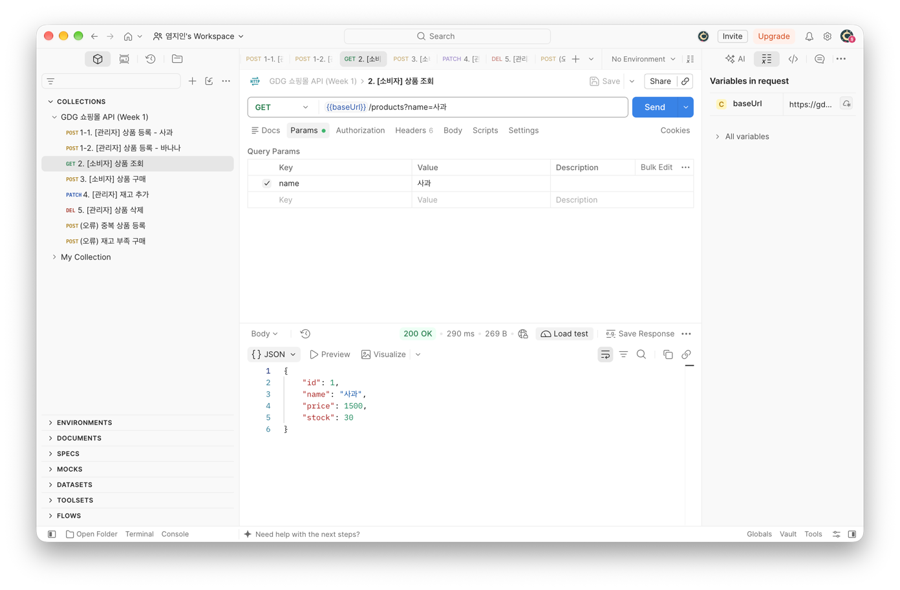
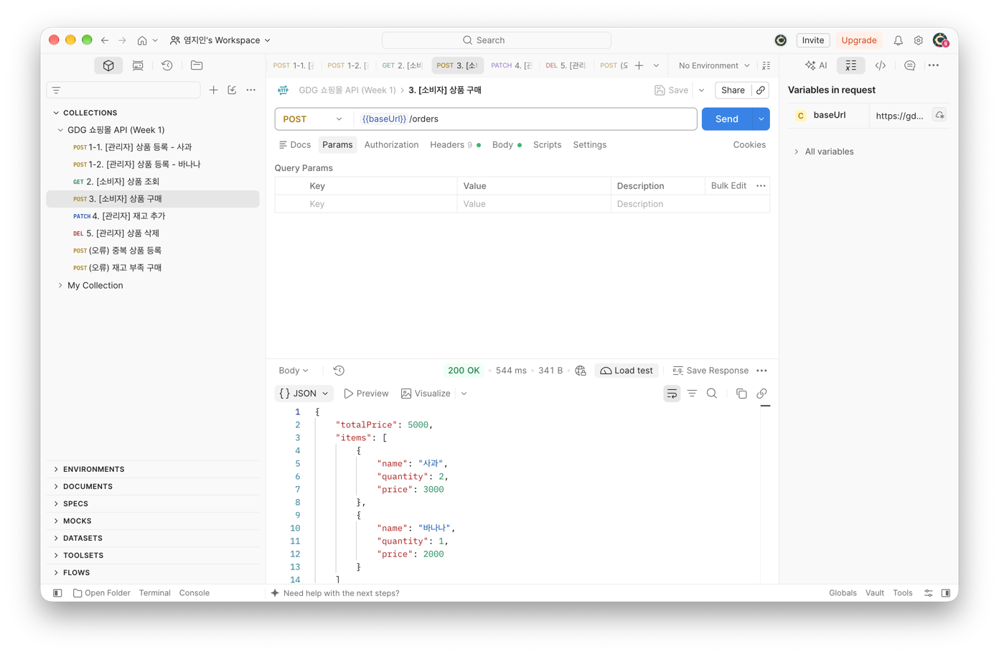
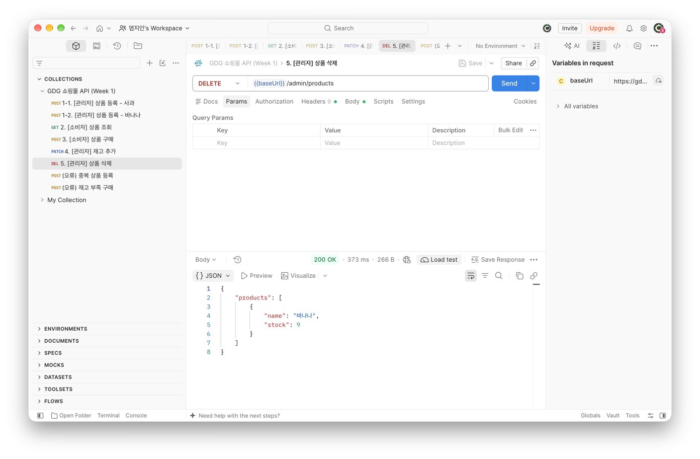
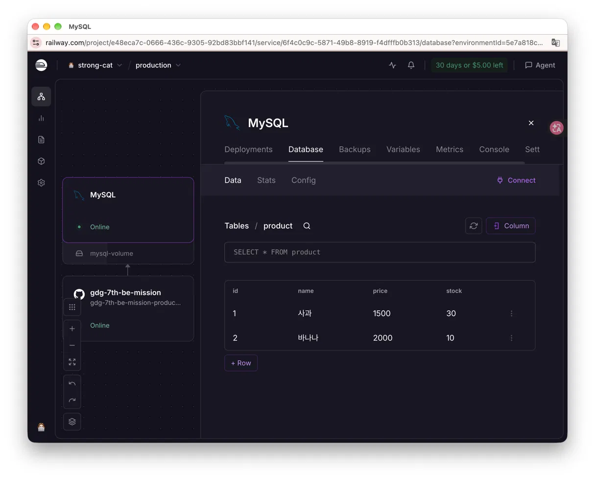
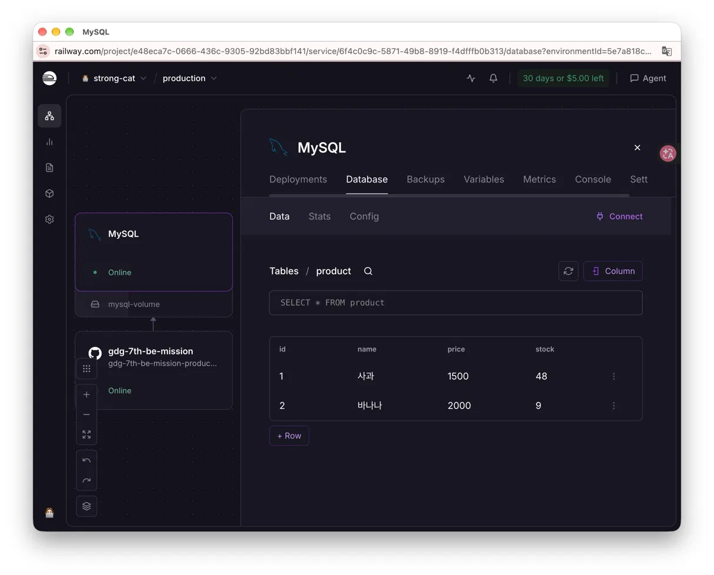
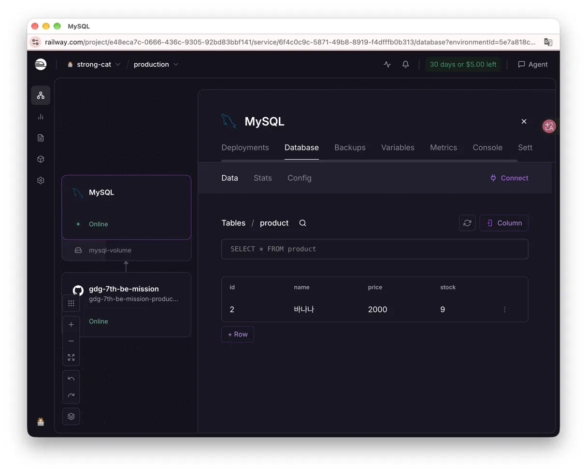
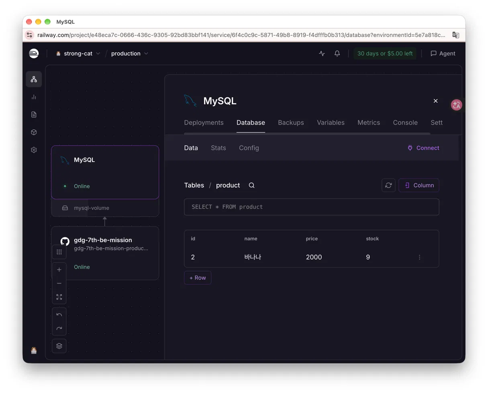

# Week 3 — 배포 및 API 테스트

- 배포 URL:  https://gdg-7th-be-mission-production-0be1.up.railway.app
- Swagger: https://gdg-7th-be-mission-production-0be1.up.railway.app/swagger-ui/index.html

## Postman 테스트 (배포 서버)
### 상품 등록

### 상품 조회

### 상품 구매

### 재고 추가

### 상품 삭제

## Railway MySQL 데이터 확인
| 단계 | 화면 |
| --- | --- |
| 등록 후 |  |
| 구매 후 |  |
| 재고 추가 후 |  |
| 삭제 후 |  |
| 재배포 후 |  |

- 구매 후 재고가 차감되고(사과 30→28), 재고 추가 결과가 48로 나와 `@Transactional` 적용 후 변경 사항이 DB에 반영됨을 확인했다.
- 재배포 후에도 데이터가 그대로 남아, 서버와 분리된 외부 DB에 저장되고 있음을 확인했다.