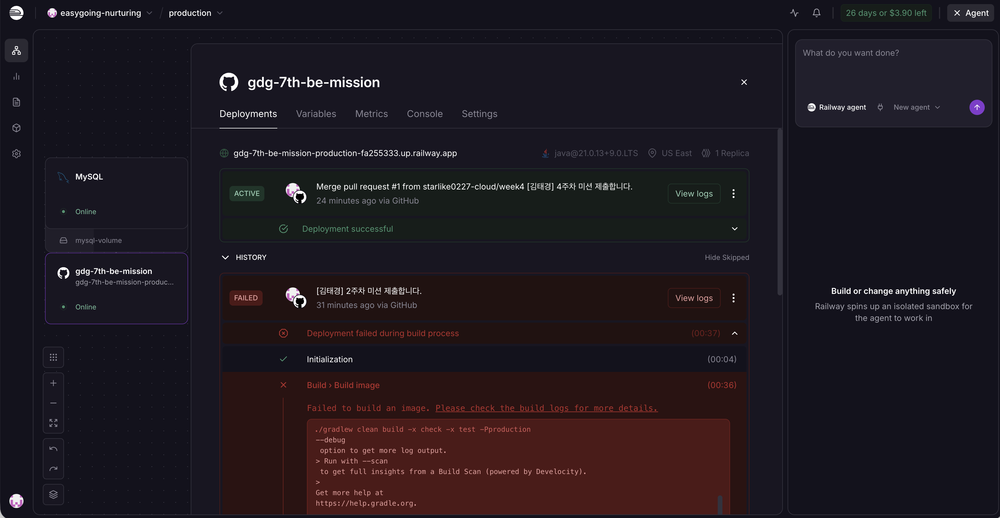

# 4주차 Railway 자동 배포 확인

`week4` 브랜치의 변경 사항을 Pull Request로 `main`에 머지했다.
머지 후 Railway의 Deployments 탭에서 새 배포가 자동으로 시작됐고,
`ACTIVE`와 `Deployment successful`이 표시되는 것을 확인했다.

## 배포된 API 확인

배포된 Swagger UI가 정상적으로 열리는 것을 확인했다.
존재하지 않는 상품명을 조회했을 때 `404 Not Found`와 함께
`{"message":"상품을 찾을 수 없습니다."}`가 반환됐다.

[배포된 Swagger UI](https://gdg-7th-be-mission-production-fa255333.up.railway.app/swagger-ui/index.html)